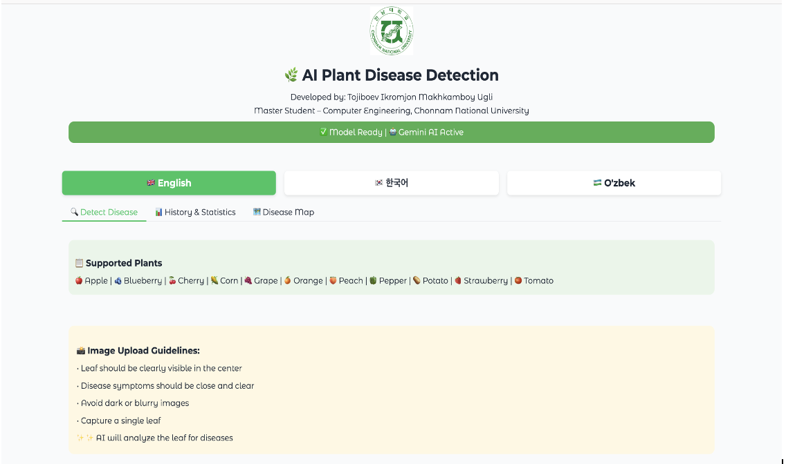
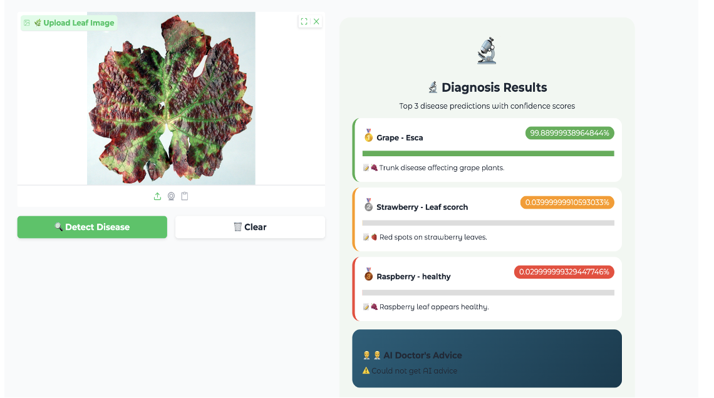
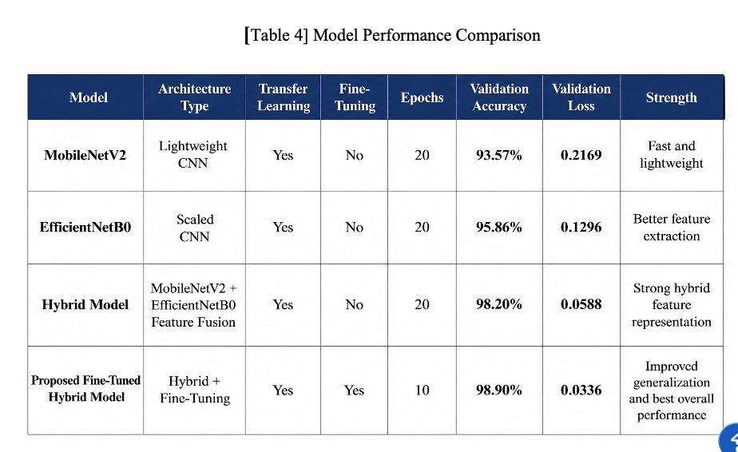
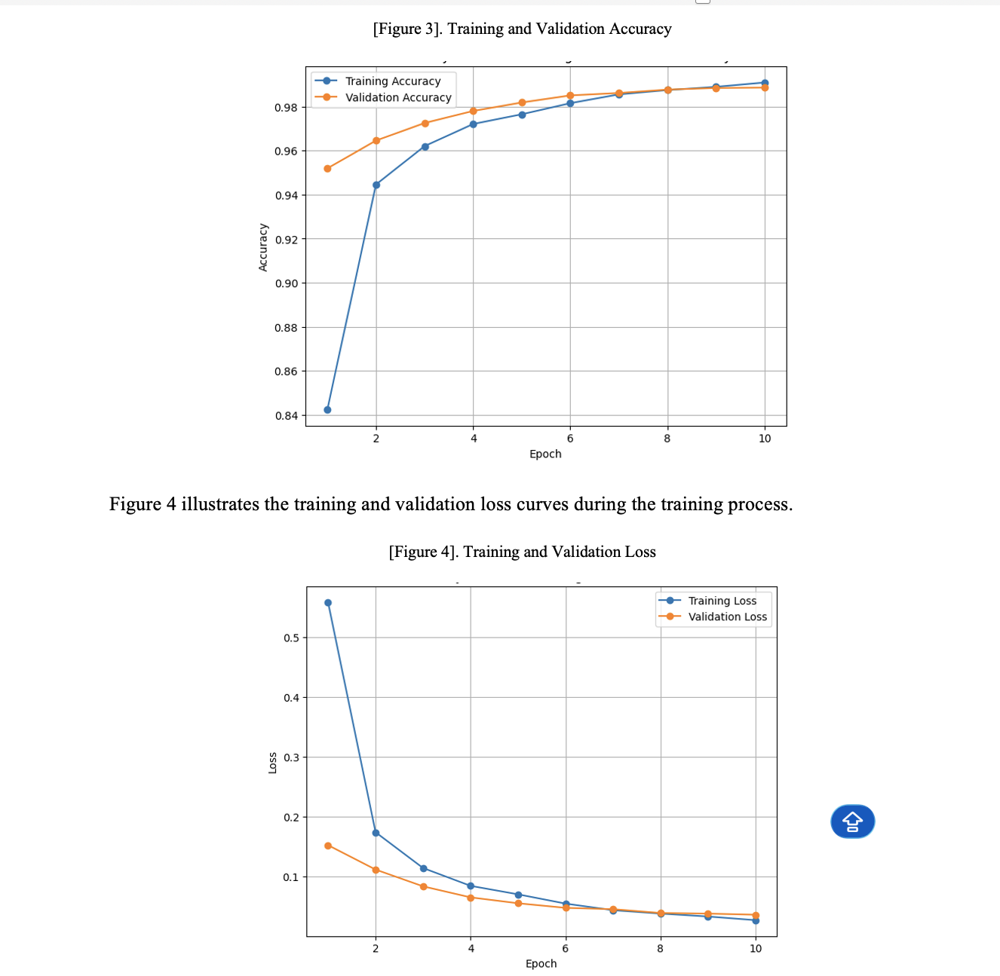
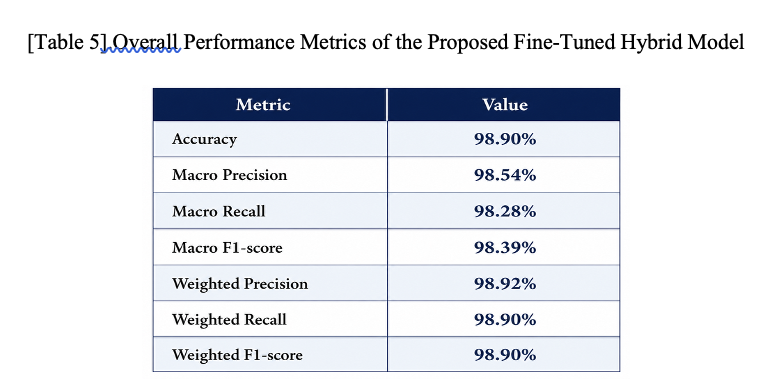

# Ekinly AI — Plant Disease Classification with Hybrid Deep Learning

> **Research prototype | Computer Vision · Deep Learning · Smart Agriculture**

## Professional Summary

Developed a hybrid deep learning framework for plant disease classification by integrating **MobileNetV2** and **EfficientNetB0** through feature-level fusion. Evaluated the proposed model across **38 PlantVillage classes**, achieving **98.90% validation accuracy** and a **98.39% macro F1-score** in the documented validation setup. Implemented a multilingual Gradio inference prototype and deployed it on Hugging Face Spaces.

<sub>Metrics are from the PlantVillage validation dataset (controlled image conditions); they do not establish field performance or production-grade diagnosis.</sub>

## Key Results

| Validation Accuracy | Macro F1-Score | Classes | Hybrid Parameters |
|:---:|:---:|:---:|:---:|
| **98.90%** | **98.39%** | **38** | **~10.3M** |

Ekinly AI is a research prototype developed at **Chonnam National University, Republic of Korea**. It studies feature-level fusion of two ImageNet-pretrained CNN backbones for 38-class plant disease classification.

- **Research project:** *Hybrid Deep Learning Framework for Plant Disease Classification Using MobileNetV2 and EfficientNetB0 Feature Fusion*
- **Live demo:** [Hugging Face Spaces](https://huggingface.co/spaces/IKROMJON01/Ekinly-Ai)
- **Research publication:** [APJCRI article](https://lnkd.in/gqXdEBKE) · [DOI](https://lnkd.in/g4WBKG7R)

---

## Research Highlights

| Result | Value |
|---|---:|
| PlantVillage images | 54,704 |
| Disease / healthy classes | 38 |
| Input image dimensions | 224 × 224 × 3 |
| Proposed hybrid validation accuracy | **98.90%** |
| Macro F1-score | **98.39%** |
| Weighted F1-score | **98.90%** |
| Hybrid model parameters | ~10.3 million |
| Trainable parameters after fine-tuning | ~1.33 million |
| Saved model artifact size | ~146.4 MB |

**Evaluation note:** These are results from the documented PlantVillage validation setup. PlantVillage images were collected under controlled conditions; the reported metrics should not be interpreted as verified performance on field photographs or as a guarantee of real-world diagnosis.

## Problem & Research Motivation

Plant diseases can reduce crop quality and yield. Manual inspection is time-consuming and requires domain expertise, while individual CNN models can have difficulty distinguishing visually similar symptoms.

The research explores a hybrid approach that combines:

- **MobileNetV2:** an efficient feature extractor designed with lightweight computation in mind.
- **EfficientNetB0:** a complementary CNN backbone for rich visual feature representation.
- **Feature-level fusion:** concatenation of the extracted feature representations before classification.
- **Transfer learning and selective fine-tuning:** adapting ImageNet-pretrained features to the PlantVillage task.

The objective is to improve classification performance while maintaining a model architecture with potential for future mobile or edge-oriented optimization.

## Proposed Method

The image classification pipeline follows these stages:

```text
Plant Leaf Image
      │
      ▼
Preprocessing
Resize to 224 × 224 · Normalize · Augment
      │
      ├──────────────────────────┐
      ▼                          ▼
 MobileNetV2                EfficientNetB0
 Feature Extraction          Feature Extraction
      │                          │
      └────────────┬─────────────┘
                   ▼
          Feature Concatenation
                   │
                   ▼
          Dense Classification Head
             + Dropout (0.5)
                   │
                   ▼
          Softmax: 38 Classes
                   │
                   ▼
       Predicted Class + Confidence
```

### Dataset and preprocessing

| Configuration | Research setting |
|---|---|
| Dataset | PlantVillage |
| Total images | 54,704 |
| Training images | 43,769 |
| Validation images | 10,935 |
| Number of classes | 38 |
| Input size | 224 × 224 × 3 |
| Normalization | Pixel values scaled to [0, 1] |
| Augmentation | Rotation (20°), zoom (0.2), width shift (0.2), height shift (0.2), horizontal flip |
| Transfer learning | ImageNet-pretrained backbone weights |

The dataset split and reported evaluation follow the thesis and article's documented experimental setup.

### Training configuration

| Hyperparameter | Value |
|---|---|
| Backbone networks | MobileNetV2 + EfficientNetB0 |
| Optimizer | Adam |
| Loss function | Categorical Cross-Entropy |
| Batch size | 64 |
| Initial training stage | 20 epochs |
| Selective fine-tuning stage | 10 epochs |
| Initial learning rate | 0.0001 |
| Fine-tuning learning rate | 0.00002 |
| Dropout rate | 0.5 |
| Training framework | TensorFlow / Keras |
| Training environment | Google Colab GPU |

## Experimental Results

### Model comparison

The following results are reported in the research experiments on the PlantVillage validation setup.

| Model | Transfer learning | Fine-tuning | Validation accuracy | Validation loss |
|---|:---:|:---:|---:|---:|
| MobileNetV2 | Yes | No | 93.57% | 0.2169 |
| EfficientNetB0 | Yes | No | 95.86% | 0.1296 |
| Hybrid MobileNetV2 + EfficientNetB0 | Yes | No | 97.94% | 0.0588 |
| **Proposed fine-tuned hybrid** | **Yes** | **Yes** | **98.90%** | **0.0336** |

The fine-tuned hybrid achieved a **5.33 percentage-point increase** in validation accuracy over the standalone MobileNetV2 baseline and a **3.04 percentage-point increase** over EfficientNetB0 in the reported experiment.

### Classification metrics

| Metric | Value |
|---|---:|
| Accuracy | **98.90%** |
| Macro Precision | 98.54% |
| Macro Recall | 98.28% |
| Macro F1-score | 98.39% |
| Weighted Precision | 98.92% |
| Weighted Recall | 98.90% |
| Weighted F1-score | 98.90% |

The thesis also includes training/validation accuracy and loss curves, a 38-class confusion matrix, and a comparison with selected previous studies. Cross-study accuracy figures use different datasets and protocols, so they are presented as context—not as a direct, controlled ranking.

## Web Prototype

A Gradio-based prototype demonstrates how the trained model can be used for image-based plant disease classification.

### Current interface capabilities

- Upload a plant leaf image and request a prediction.
- Display the top three predicted classes with confidence scores.
- Provide a multilingual interface: **English, Korean, and Uzbek**.
- Offer prediction history and statistics.
- Include a disease-map interface/prototype.
- Provide optional AI-generated agricultural guidance through Gemini when configured.

The prototype is intended to demonstrate the research workflow. It is not a certified plant pathology diagnostic service.

**Live demo:** [Ekinly AI — Hugging Face Spaces](https://huggingface.co/spaces/IKROMJON01/Ekinly-Ai)

## Project Screenshots

The README highlights five representative visuals for a recruiter-friendly overview. Additional dataset configuration and literature-comparison figures are available in the [Research Results documentation](docs/RESEARCH_RESULTS.md).

### Web application

<p align="center">
  
</p>

### Prediction output

<p align="center">
  
</p>

### Model experiment comparison

<p align="center">
  
</p>

### Training and validation curves

<p align="center">
  
</p>

### Classification evaluation

<p align="center">
  
</p>

## Technology Stack

- **Language:** Python
- **Deep learning:** TensorFlow, Keras
- **CNN architectures:** MobileNetV2, EfficientNetB0
- **Data / evaluation:** PlantVillage, image augmentation, classification metrics, confusion matrix
- **Web application:** Gradio
- **AI guidance (optional):** Gemini API
- **Deployment:** Hugging Face Spaces
- **Training environment:** Google Colab GPU

## My Contributions

Research and implementation work documented for this project:

- Built the experimental pipeline for the PlantVillage 38-class classification task, including image preprocessing and augmentation.
- Integrated MobileNetV2 and EfficientNetB0 feature extractors and implemented feature-level fusion with a classification head.
- Applied transfer learning and selective fine-tuning; recorded training and validation results for individual backbones and hybrid variants.
- Produced quantitative evaluation using accuracy, precision, recall, macro/weighted F1-score, loss curves, and confusion-matrix analysis.
- Implemented the Gradio inference interface with top-3 predictions and multilingual UI (English, Korean, Uzbek).
- Connected optional Gemini-based guidance and the prototype's prediction-history/statistics interface.
- Packaged and deployed the research demonstration on Hugging Face Spaces.

This list describes the documented project scope; it does not imply that every production engineering component is complete.


## Limitations and Future Work

### Limitations

- PlantVillage is a controlled dataset and may not represent the lighting, backgrounds, occlusion, and image variability of agricultural fields.
- Validation metrics do not establish field-level reliability or clinical/agronomic certainty.
- The saved model is approximately 146.4 MB; deployment on resource-constrained devices may require optimization.
- Gemini-generated guidance is optional AI output and should not be treated as expert agronomic advice.
- The prototype is a research and portfolio demonstration, not a certified diagnostic product.

### Future directions

- Evaluate on field-collected images and external datasets.
- Conduct feature-fusion ablation studies and test alternative fusion strategies.
- Add confidence calibration and uncertainty estimation.
- Explore quantization, pruning, and mobile/edge deployment.
- Improve model versioning, monitoring, and persistent application storage.

## Run Locally

### Requirements

Use Python 3.10 and install the dependencies:

```bash
python -m venv .venv

# macOS / Linux
source .venv/bin/activate

# Windows PowerShell
# .venv\\Scripts\\Activate.ps1

pip install -r requirements.txt
python app.py
```

The application expects the trained model file `proposed_hybrid_finetuned_final.keras` in the project directory by default. Set `MODEL_PATH` if the model is mounted elsewhere. Alternatively, set `MODEL_URL` to a direct HTTPS URL for the model; the app can download it at startup when the configured local file is absent.

Optional Gemini guidance requires `GEMINI_API_KEY`. The application can run without this key, but Gemini-based advice will be unavailable.

### Docker

```bash
docker build -t ekinly-ai .
docker run --rm -p 7860:7860 \\
  -e MODEL_PATH=/models/proposed_hybrid_finetuned_final.keras \\
  -v /absolute/path/to/model-directory:/models:ro \\
  ekinly-ai
```

Use deployment secrets for API keys and private model URLs. Do not commit credentials or access tokens.

## Deployment and Engineering Notes

- The trained `.keras` model is not stored in this GitHub repository; provide it through a mounted path or configured model URL.
- Startup may require network access when the model is downloaded, and TensorFlow initialization can increase cold-start time and memory use.
- Prediction history is currently stored in a local `diseases_data.json` file. Container restarts or multiple replicas may lose or split this data; persistent storage or a database would be needed for durable production history.
- The GitHub Actions workflow checks Python syntax, dependency declarations, and Docker image buildability. These checks do not constitute a full inference, model-quality, or security test.
- After deployment, run an inference smoke test with a known leaf image and confirm that the application returns the expected prediction structure.

## Research Publication

### Fine-Tuned Hybrid Deep Learning Framework for Plant Disease Classification Using MobileNetV2 and EfficientNetB0 Feature Fusion

**Published research article** — *Asia-Pacific Convergence Research Exchange Journal (APJCRI)*, Vol. 12, No. 9, September 2026, pp. 363–378. The journal is described as KCI-indexed in the publication announcement.

The paper presents a hybrid deep learning framework combining MobileNetV2 and EfficientNetB0 through feature-level fusion and fine-tuning. The proposed framework achieved **98.90% classification accuracy** on the documented PlantVillage validation setup.

| Publication resource | Link |
|---|---|
| KCI article page | [View article](https://lnkd.in/gqXdEBKE) |
| DOI | [Open DOI](https://lnkd.in/g4WBKG7R) |
| Related Ekinly AI project / video | [View project](https://lnkd.in/gJbKKXuA) |


## Project Links

| Resource | Link |
|---|---|
| **Research paper** | [APJCRI article page (KCI)](https://lnkd.in/gqXdEBKE) |
| **DOI** | [Publication DOI](https://lnkd.in/g4WBKG7R) |
| **Master's thesis** | Thesis details are summarized in this repository; a public full-text link has not been provided here. |
| **Live demo** | [Ekinly AI on Hugging Face Spaces](https://huggingface.co/spaces/IKROMJON01/Ekinly-Ai) |
| **GitHub repository** | [ikromjon-gif/Ekinly-AI](https://github.com/ikromjon-gif/Ekinly-AI) |
| **Related project/video** | [Ekinly AI project link](https://lnkd.in/gJbKKXuA) |

## Technical Skills Demonstrated

Python · TensorFlow / Keras · Transfer Learning · CNNs · MobileNetV2 · EfficientNetB0 · Feature Fusion · Fine-Tuning · Image Augmentation · Model Evaluation · Gradio · Hugging Face Spaces

## Author

**Ikromjon Tojiboev**  
M.S. Computer Engineering, Chonnam National University  
Republic of Korea

---

*Ekinly AI is a research project focused on hybrid deep learning, feature fusion, and AI-assisted plant disease classification.*
