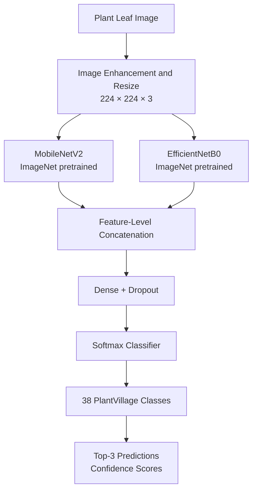

# 🌱 Ekinly AI
### AI-Powered Plant Disease Classification with Hybrid Deep Learning

[](https://github.com/ikromjon-gif/Ekinly-AI/actions/workflows/quality-check.yml)
[](https://www.python.org/)
[](https://www.tensorflow.org/)
[](https://www.gradio.app/)
[](https://huggingface.co/spaces/IKROMJON01/Ekinly-Ai)

**Ekinly AI** is a research and portfolio project that applies a fine-tuned hybrid convolutional neural network to classify plant leaf diseases. The system combines **MobileNetV2** and **EfficientNetB0** through feature-level fusion and presents predictions in an interactive, multilingual web application.

<p align="center">
  <a href="https://huggingface.co/spaces/IKROMJON01/Ekinly-Ai"><strong>🚀 Try the Live Demo</strong></a>
  &nbsp;·&nbsp;
  <a href="#-methodology"><strong>Explore the Method</strong></a>
  &nbsp;·&nbsp;
  <a href="#-run-locally"><strong>Run Locally</strong></a>
</p>

---

## Table of Contents

- [Project Overview](#-project-overview)
- [Key Features](#-key-features)
- [Methodology](#-methodology)
- [Model Configuration](#-model-configuration)
- [Evaluation](#-evaluation)
- [Application](#-application)
- [Technology Stack](#-technology-stack)
- [Run Locally](#-run-locally)
- [Run with Docker](#-run-with-docker)
- [Configuration](#-configuration)
- [CI Checks](#-ci-checks)
- [Limitations and Responsible Use](#-limitations-and-responsible-use)
- [Future Work](#-future-work)
- [Research Context](#-research-context)
- [Author](#-author)

## 🔎 Project Overview

Plant disease classification from leaf images is a computer-vision task with practical relevance to smart agriculture. Lightweight neural networks can support efficient inference, while larger architectures may learn complementary visual representations.

Ekinly AI investigates a hybrid approach that fuses feature representations from two ImageNet-pretrained backbones. The resulting classifier predicts one of **38 PlantVillage classes** and returns the three highest-ranked predictions with confidence scores.

> **Research result:** The project reports **98.90% validation accuracy** on its documented PlantVillage evaluation setup. This is a controlled-dataset result and should not be interpreted as expected accuracy in real agricultural field conditions.

## ✨ Key Features

- **Hybrid CNN classifier:** MobileNetV2 + EfficientNetB0 feature-level fusion.
- **Top-3 predictions:** Displays the three leading class predictions and confidence scores.
- **Multilingual interface:** English, Korean, and Uzbek.
- **Optional AI-generated guidance:** Gemini-powered explanatory advice when a valid API key is configured.
- **Prediction history and statistics:** Stores prediction records in a local JSON file.
- **Disease map interface prototype:** Includes a browser location-sharing interaction.
- **Interactive web application:** Built with Gradio.
- **Deployment options:** Hugging Face Spaces and Docker-based deployment.

## 🧠 Methodology

The image is resized to 224 × 224 and passed through both pretrained feature extractors. Their representations are concatenated and fed into a classification head.



### Training and modeling approach

- **Transfer learning:** ImageNet-pretrained MobileNetV2 and EfficientNetB0 backbones.
- **Fusion strategy:** Feature-level concatenation.
- **Fine-tuning:** Selective fine-tuning of upper layers.
- **Optimizer:** Adam.
- **Loss function:** Categorical cross-entropy.
- **Batch size:** 64.
- **Input resolution:** 224 × 224 pixels.
- **Dataset:** PlantVillage.
- **Number of classes:** 38.

## ⚙️ Model Configuration

| Component | Configuration |
|---|---|
| Task | Plant leaf disease classification |
| Dataset | PlantVillage |
| Classes | 38 |
| Input shape | 224 × 224 × 3 |
| Feature extractors | MobileNetV2, EfficientNetB0 |
| Pretrained weights | ImageNet |
| Fusion | Feature-level concatenation |
| Fine-tuning | Selective upper-layer fine-tuning |
| Classification head | Dense + Dropout + Softmax |
| Optimizer | Adam |
| Loss | Categorical cross-entropy |
| Batch size | 64 |

## 📊 Evaluation

| Metric | Result |
|---|---:|
| Validation accuracy | **98.90%** |

The research evaluation also includes precision, recall, F1-score, and confusion-matrix analysis.

**Interpretation note:** The reported accuracy is tied to the documented PlantVillage validation setup. Dataset conditions may differ from field images in lighting, background, camera quality, plant variety, and symptom severity. Real-world generalization requires separate field testing.

## 🖥️ Application

The Gradio interface provides:

1. Leaf image upload and image-quality guidance.
2. Disease classification with the top three predictions.
3. Confidence scores and brief class descriptions.
4. Optional Gemini-generated agricultural guidance.
5. English, Korean, and Uzbek interface options.
6. Local prediction history and summary statistics.
7. A prototype location-sharing interaction.

### Supported plant categories

The current 38-class label set includes examples across apple, blueberry, cherry, corn, grape, orange, peach, bell pepper, potato, raspberry, soybean, squash, strawberry, and tomato.

## 🧰 Technology Stack

| Area | Technologies |
|---|---|
| Language | Python 3.10 |
| Deep learning | TensorFlow, Keras |
| Computer vision | OpenCV, Pillow, NumPy |
| Model architectures | MobileNetV2, EfficientNetB0 |
| Web interface | Gradio |
| AI guidance | Google Gemini API (optional) |
| Deployment | Hugging Face Spaces, Docker |
| CI | GitHub Actions |

## 🚀 Run Locally

### Prerequisites

- Python 3.10
- Git
- The trained model artifact, or a direct HTTPS URL from which it can be downloaded

### 1. Clone the repository

```bash
git clone https://github.com/ikromjon-gif/Ekinly-AI.git
cd Ekinly-AI
```

### 2. Create and activate a virtual environment

**macOS / Linux**

```bash
python3.10 -m venv .venv
source .venv/bin/activate
```

**Windows PowerShell**

```powershell
py -3.10 -m venv .venv
.venv\Scripts\Activate.ps1
```

### 3. Install dependencies

```bash
python -m pip install --upgrade pip
pip install -r requirements.txt
```

### 4. Configure the model

The model file is not committed to this repository. Provide it locally using `MODEL_PATH`, or configure `MODEL_URL` to point to a direct HTTPS download URL.

**macOS / Linux**

```bash
export MODEL_PATH="./proposed_hybrid_finetuned_final.keras"
# Optional alternative:
# export MODEL_URL="https://your-host.example/path/to/model.keras"
```

**Windows PowerShell**

```powershell
$env:MODEL_PATH = ".\proposed_hybrid_finetuned_final.keras"
# Optional alternative:
# $env:MODEL_URL = "https://your-host.example/path/to/model.keras"
```

### 5. (Optional) Configure Gemini

Gemini-based guidance is optional. Set the API key as an environment variable; do not commit secrets.

**macOS / Linux**

```bash
export GEMINI_API_KEY="your_api_key"
```

**Windows PowerShell**

```powershell
$env:GEMINI_API_KEY = "your_api_key"
```

### 6. Start the application

```bash
python app.py
```

The Gradio server uses port **7860** by default. Open [http://localhost:7860](http://localhost:7860) in your browser.

## 🐳 Run with Docker

Build the image:

```bash
docker build -t ekinly-ai .
```

Run the container with a locally mounted model:

```bash
docker run --rm -p 7860:7860 \
  -e MODEL_PATH=/models/proposed_hybrid_finetuned_final.keras \
  -v /absolute/path/to/model-directory:/models:ro \
  ekinly-ai
```

If using Gemini guidance, pass `GEMINI_API_KEY` through your environment or deployment platform's secret manager.

## 🔧 Configuration

| Environment variable | Purpose | Default |
|---|---|---|
| `MODEL_PATH` | Local or mounted model file path | `proposed_hybrid_finetuned_final.keras` |
| `MODEL_URL` | Direct HTTPS model download URL used when the model file is absent | Hugging Face model URL in application code |
| `GEMINI_API_KEY` | Enables optional Gemini guidance | Unset |
| `PORT` | Gradio server port | `7860` |
| `GRADIO_SERVER_NAME` | Gradio bind address | `0.0.0.0` |
| `GRADIO_SERVER_PORT` | Explicit Gradio server port override | Falls back to `PORT` |

## ✅ CI Checks

The GitHub Actions workflow runs on pushes to `main` and `audit/**`, and on pull requests targeting `main`.

Current checks:

- Python syntax compilation for `app.py`.
- Verification that required direct dependencies are declared.
- Docker image build.

[View workflow runs](https://github.com/ikromjon-gif/Ekinly-AI/actions)

These checks validate source syntax, dependency declarations, and image buildability. They do **not** test model loading, live inference quality, deployment health, or field performance.

## ⚠️ Limitations and Responsible Use

- **Controlled dataset:** PlantVillage images do not fully represent real field conditions.
- **No field-performance guarantee:** Validation accuracy is not a guarantee of correct predictions for an individual plant.
- **Research prototype:** Ekinly AI is not a certified plant diagnostic service and should not replace qualified agricultural assessment.
- **AI-generated advice:** Gemini responses may be incomplete or inaccurate; verify recommendations with reliable agricultural expertise.
- **Model artifact management:** The trained model is hosted separately. Deployment requires a mounted model file or a reachable direct HTTPS model URL.
- **Prediction storage:** History is currently stored in `diseases_data.json`; ephemeral containers or multiple replicas can lose or diverge in stored records.
- **Location interaction:** The current browser location feature is a prototype interaction and should not be considered a complete geospatial disease-tracking system.
- **Secrets:** Never commit API keys, access tokens, or private model URLs.

## 🔭 Future Work

- Evaluate on field images and additional datasets.
- Conduct feature-fusion ablation studies.
- Add confidence calibration and uncertainty estimation.
- Optimize inference for edge and mobile deployment.
- Track model version, checksum, and artifact provenance.
- Add inference smoke tests and deployment monitoring.
- Replace local JSON prediction history with persistent database storage where required.
- Develop a retrieval-augmented agricultural assistant.

## 🎓 Research Context

**Research title:** *Fine-Tuned Hybrid Deep Learning Framework for Plant Disease Classification Using MobileNetV2 and EfficientNetB0 Feature Fusion*

**Program:** M.S. Computer Engineering  
**Institution:** Chonnam National University  
**Year:** 2026

## 👨‍💻 Author

**Ikromjon Tojiboev**  
M.S. Computer Engineering, Chonnam National University

- GitHub: [@ikromjon-gif](https://github.com/ikromjon-gif)
- Project repository: [Ekinly-AI](https://github.com/ikromjon-gif/Ekinly-AI)
- Live demo: [Ekinly AI on Hugging Face Spaces](https://huggingface.co/spaces/IKROMJON01/Ekinly-Ai)

---

<p align="center">
  <strong>Ekinly AI</strong><br/>
  Researching intelligent and practical approaches to plant disease classification.
</p>
