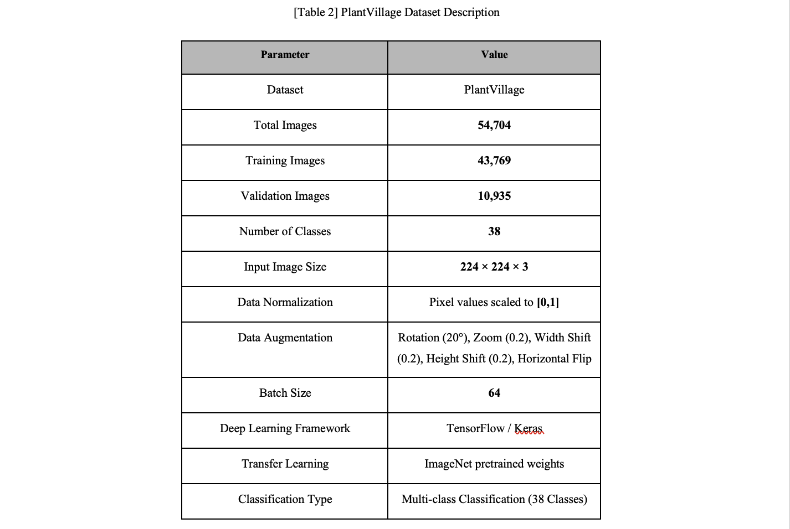
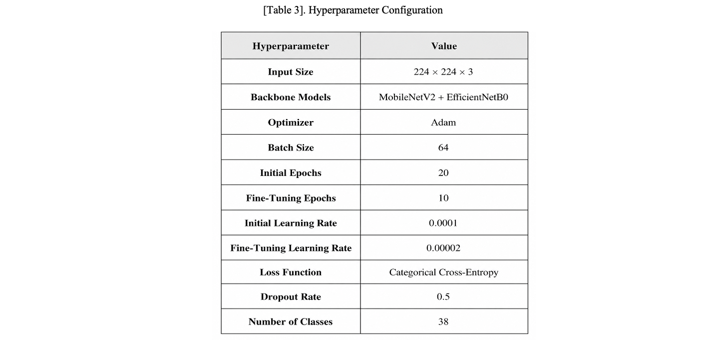
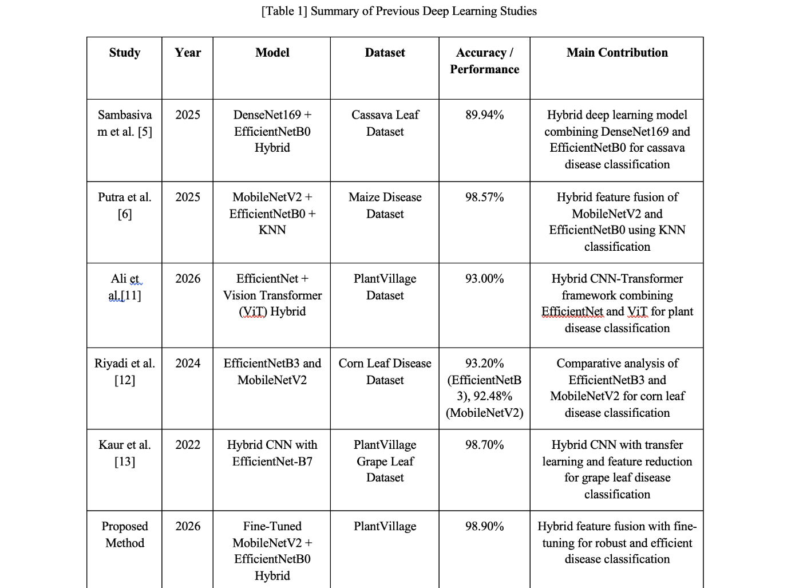
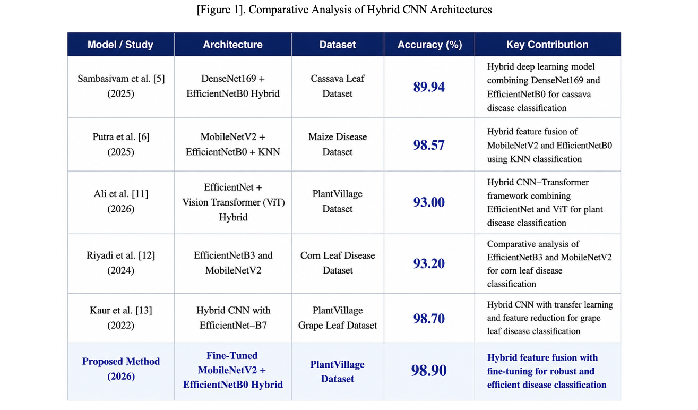
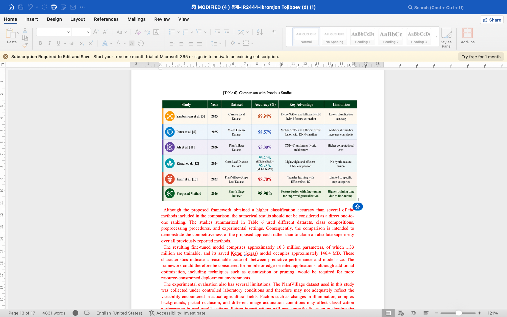

# Ekinly AI — Supplementary Research Results

This page contains supporting figures from the PlantVillage experiments. The headline metrics refer to the documented validation setup and should not be interpreted as field-validated performance.

## Dataset overview

  

## Training hyperparameters

  

## Related literature and architecture comparisons

### Previous studies summary

  

### Comparative hybrid CNN architectures

  

### Thesis comparison table

  

